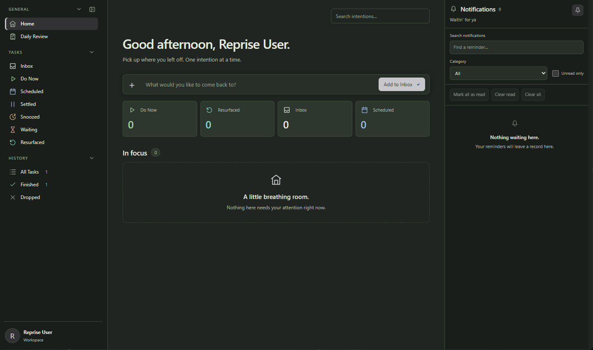



  

<strong>Later should actually arrive.</strong>

  <a href="https://github.com/Ninefarer/Reprise/releases/latest"><strong>Download for Windows</strong></a> ·
  <a href="docs/GETTING-STARTED.md">Getting started</a> ·
  <a href="https://github.com/Ninefarer/Reprise/releases">Release notes</a> ·
  <a href="https://github.com/Ninefarer/Reprise/issues">Report an issue</a>

Reprise is a Windows task manager for the things you intend to come back to. Capture an intention, make room when you need to, and return without losing your place.

## Make room. Keep your place.

**Capture first.** Put a thought in Inbox without choosing a date or a priority. Quick Capture opens with **Ctrl+Shift+Space**, even when the main window is tucked away.

**Pause on purpose.** Snooze something for a little later, or Settle it until tomorrow or 24 hours from now. Its schedule and deadline stay intact.

**Come back with a choice.** Returned tasks wait in Resurfaced. Start one, schedule it, pause it again, or let it go. A reminder never decides that you're working on something.

[How tasks return](docs/TASK-WORKFLOW.md) explains Settled, Snoozed, Waiting, and the review queue.

## Get Reprise

Reprise runs on **Windows 11, x64**. No account is required, and your tasks are stored on your device.

Download the `.exe` installer from the [latest Stable release](https://github.com/Ninefarer/Reprise/releases/latest), run it, and open Reprise. You do not need Node or Rust to use the app.

The repository is currently private; downloads and issues require repository access.

Want to help test upcoming changes? [Nightly builds](https://github.com/Ninefarer/Reprise/releases?q=nightly&expanded=true) are marked **Pre-release**. They install separately and keep their own task data. Stable is the everyday download; Nightly may have bugs or unfinished changes.

[Installation and first run](docs/GETTING-STARTED.md) covers updates, running in the tray, and using both channels.

## A few things worth knowing

- Core task management works offline. No cloud service is required.
- Closing the window can leave Reprise running in the tray so reminders can return. **Quit Reprise** stops that background process.
- Windows controls whether a notification appears. Reprise also keeps its own notification history.
- Updates are currently installed manually; the signed in-app update feed is not connected.

## Find your way around

- [Getting started](docs/GETTING-STARTED.md): install, capture a task, and find Settings.
- [Task workflow](docs/TASK-WORKFLOW.md): choose what to do now and what to return to later.
- [Full changelog](CHANGELOG.md): additions, changes, and fixes in Stable 3.3.0.
- [All documentation](docs/README.md): user guides and the engineering records behind the app.

Found something wrong? [Open an issue](https://github.com/Ninefarer/Reprise/issues) with what you expected, what happened, and your version. Keep private task details out of screenshots and reports.

## Working on Reprise

Reprise uses Tauri 2, Rust, React, TypeScript, and SQLite. See [Building Reprise](docs/BUILDING.md) for prerequisites, local builds, and checks, or [Architecture and reliability](docs/ARCHITECTURE.md) for storage and scheduling details.
