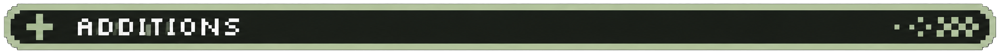
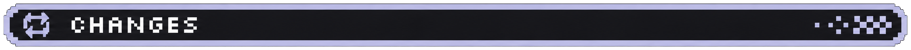
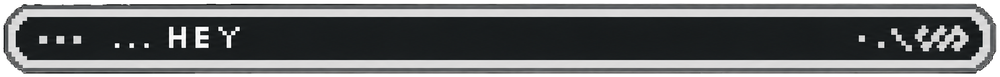

# Reprise 3.3.0

Later should actually arrive.

- Added a focused three-step setup for your profile, theme, return preferences, and first task.
- Added the option to redo onboarding from Settings without wiping your tasks or history.
- Added working Cut, Copy, Paste, Select All, Undo, and Redo menus in text fields, task details, and Quick Capture.
- Added installation and task guides, a full changelog, and a new repository introduction featuring the original wordmark and a Stable screenshot.

- Task, navigation, and editing menus now share icons, shortcuts, keyboard navigation, and subtle animations that follow your theme.
- Onboarding has smoother transitions and keeps navigation out of the way until you finish; Stable follows your selected theme, while the stars stay in Nightly.
- Updated the app, tray, installer, and uninstaller icons with the original Stable and Nightly artwork.

- Fixed context menus appearing behind dialogs, overflowing window edges, and closing a newly opened menu after rapid right-clicks.
- Fixed menu dismissal interfering with task dialogs or Quick Capture drafts, and protected fields against delayed paste results.
- Fixed reminder clicks opening stale or deleted tasks, and made them wait while another task editor is open.
- Fixed obsolete queued reminders after finishing or rescheduling, and restored the right pending reminders when using Undo.

[Full additions, changes, and fixes](https://github.com/Ninefarer/Reprise/blob/v3.3.0/CHANGELOG.md)

Wow, what a release. I spent a lot of time going back and fourth with agents and reviewing lines of code. In short... I've been working hard, behind the scenes. If you've peeped nightly releases, you'd know I've been working hard to finally get this out.

Reprise is likely going to have UI and better perf next update, but otherwise here we are. As always, if you find an issue, you can always send one to the [issues page on git](https://github.com/Ninefarer/Reprise/issues) and I will take a look. Speaking of issues... there's going to be a new way to check on that really shortly in the next release!

-Nine
