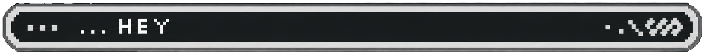

# Reprise 3.4.5

- Namecards show your profile and task milestones with Classic, Holographic, Polychrome and Foil finishes, responsive tilt and rainbow effects.
- Share a namecard by copying it to the clipboard as an image.
- Choose Solid or Glass independently of your color theme, with Clear, Regular and Tinted glass and Fluid, Subtle or Reduced motion.

- Softer rounded corners, more substantial glass surfaces and responsive transitions across navigation, menus, dialogs and Quick Capture.
- Appearance settings separate Theme, Aesthetic and Motion while preserving your saved preferences.
- Inbox lives in Hub, compact rows stay compact, and decorative colored edge strips give way to clearer labels.
- Settings Save and Discard controls stay above the active section while scrolling.
- Notifications follow your theme and glass settings, and Windows reminders include project, priority, deadline and waiting context.
- More greetings for each time of day, shorter placeholders and clearer empty states.

- Clear glass retains native desktop diffusion with readable tint and accessible solid fallbacks.
- Manual update checks reveal and focus their results, including previously cleared offers, and explain errors in plain language.
- Motion handles interrupted transitions, closing overlays and reduced-motion preferences more consistently.

I know I said a while ago that the latest release would be the last for the longest, but i genuinely couldn’t help myself. I have more ideas on the way before I go back to doing my own thing… anyway, let me know what you think about the new rounded corners and glass looks. As always if you find issues or have problems, open a PR or issue. (p.s.: reprise-bot kinda gardens now so that should be fun if I get PRs…) ~~P.s.s: I can’t help myself from playing genshin, raaaaah…~~
